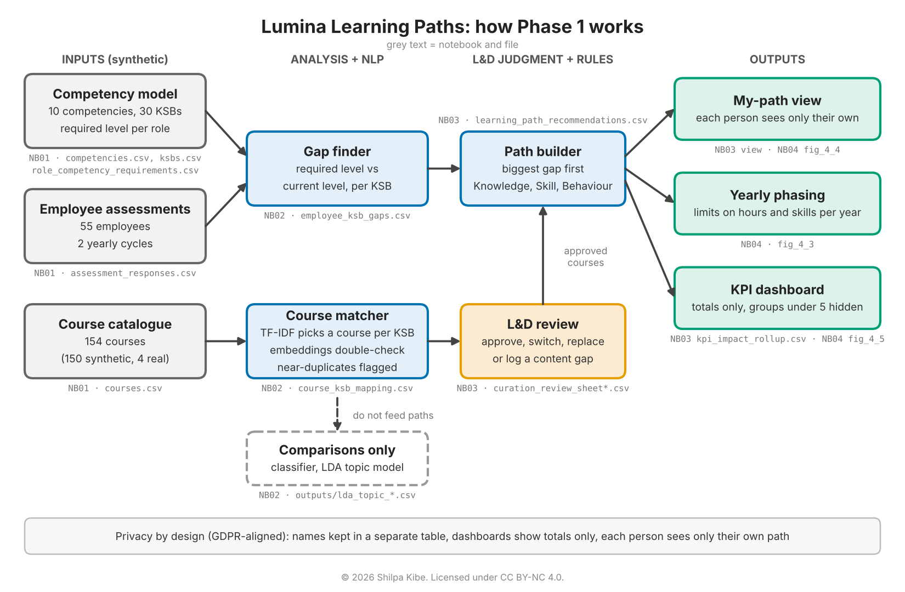
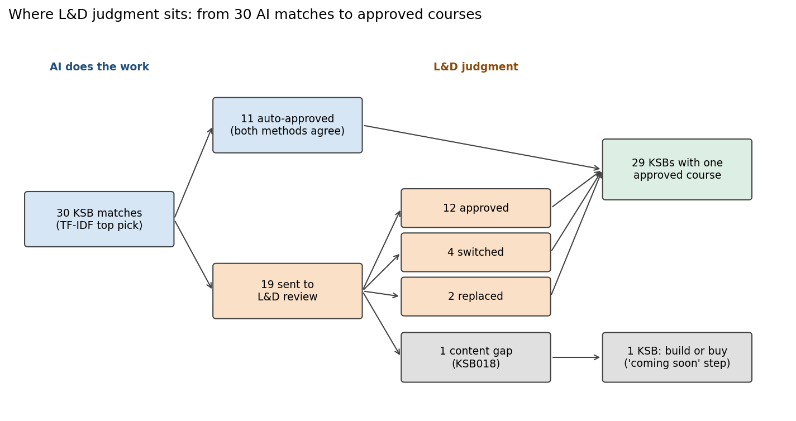
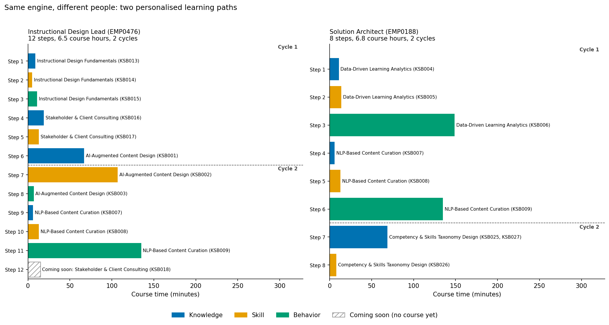
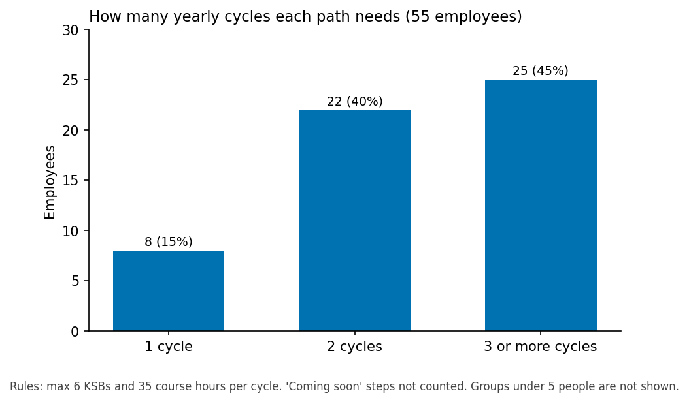
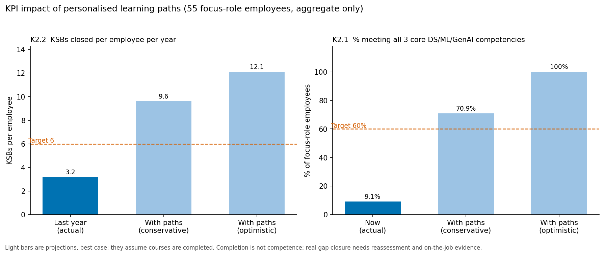

# Lumina Learning Paths

**Personalised learning paths for an L&D workforce, built with NLP and machine learning.**

This project shows how AI/ML concepts apply to a real L&D problem: finding each employee's skill gaps and building a learning path that closes them. It is set in a fictional company, Lumina Learning Group, and runs on synthetic data.

> **Status:** Phase 1 complete (NB01 to NB04). Phases 2 and 3 will be added as updates.

---

## The problem

Lumina Learning Group (LLG) is a fictional 1,000-person learning services company with offices in Pune, Austin and Manchester. Clients want learning that fits each person, not a fixed course catalogue. LLG's own staff also need to build AI skills.

Today, LLG matches people to courses by hand or by role. That has three weaknesses:

1. There is no clear link between what a role needs and what a person can do, so the gap is never measured.
2. Courses are loosely tagged, so it is hard to pick the right course for a specific gap.
3. "Personalisation" is a claim, not something LLG can show.

This project builds a working answer for two roles: **Instructional Design Lead** and **Solution Architect**.

---

## How it works



| Step | What it does | Notebook |
|---|---|---|
| 1. Build the company | Creates the org, roles, competencies, KSBs (Knowledge, Skill, Behaviour), employees, assessments and a course catalogue. Assessments include proficiency questions plus COM-B questions (Capability, Opportunity, Motivation). All synthetic. | NB01 |
| 2. Find gaps and match courses | Compares each employee's level to what their role needs. Matches courses to each KSB by the words they share, and checks the picks with a second, meaning-based method. Flags near-duplicate courses. | NB02 |
| 3. Review and build paths | An L&D reviewer checks the uncertain matches blind. Approved courses become ordered learning paths. Each employee can view only their own path. | NB03 |
| 4. Show the results | Charts for the review step, path phasing, two example paths and the KPI dashboard. | NB04 |

**Key design choices**

- **Human in the loop:** no course reaches a learner without L&D approval.
- **Explainable:** every match lists the keywords behind it; every path step says why it is there.
- **Honest about gaps:** if no good course exists, the path shows a "coming soon" step with interim support, instead of a weak course.
- **Privacy by design (GDPR-aligned):** names are kept in a separate table, dashboards show totals only, groups under 5 people are hidden, and each person sees only their own path. Full GDPR compliance also needs organisational steps: a lawful basis, a DPIA, privacy notices, and a rule that paths are used for development, not performance decisions.
- **Built to grow:** the data model is designed so later updates need no rebuild.

---

## Results

### Where L&D judgment sits



- The matcher suggested one course for each of the 30 KSBs.
- 11 were approved automatically (both methods agreed and scores were close).
- 19 went to blind L&D review: 12 approved, 4 switched, 2 replaced, 1 rejected with no replacement.
- The rejected one (KSB018) is a real content gap: 19 employees see a "coming soon" step.

### Two roles, two different paths



- 55 employees in the two focus roles each get their own path: 5 to 21 steps, 11.6 on average.
- The example ID Lead and Solution Architect get different courses in a different order, because their gaps differ.
- Order rule: biggest gap first, then Knowledge before Skill before Behaviour.

### How many years a path takes



- Paths are split into yearly cycles with two limits: hours of learning and number of skills a person can take on.
- 8 employees need 1 year, 22 need 2, and 25 need 3 or more.
- Time is not the limit (6.6 course hours per path on average). How much change a person can absorb is.

### Impact on company goals



| KPI | Today | Projected with paths | Target |
|---|---|---|---|
| Skill gaps closed per employee per year | 3.2 | 9.6 to 12.1 | 6 |
| Staff meeting the AI skills bar | 9.1% | 70.9% to 100% | 60% |

Projections are best case. Finishing a course is not the same as being competent.

### Method checks

- The word-based and meaning-based matchers picked the same top course for 17 of 30 KSBs. Where they differed, both picks were valid courses, so the review became a choice, not a correction.
- Near-duplicate detection found 27 courses in 12 groups.
- A supervised classifier and topic modelling (LDA) were run as comparisons only. They do not feed the paths.

---

## Limits

- **All data is synthetic.** The company, employees, assessments and 150 of the 154 courses are made up. 4 courses use real public arXiv abstracts as a small realism check.
- **Synthetic text is easy to match.** Generated course text uses clear words per competency, so methods score higher than they would on a real catalogue.
- **Completion is not competence.** Real gap closure needs reassessment, manager feedback and on-the-job evidence. The project stops at outputs, not outcomes.
- **Seat time only.** Course minutes do not include practice or on-the-job application.
- **Privacy is a demo.** Login is simulated. Encryption, consent and data retention are documented, not built.

---

## Roadmap

- Phase 2: GenAI upgrade, coming soon
- Phase 3: coming soon

---

## Repository layout

```
lumina-learning-paths/
├── config/          project settings and results summary (config.json)
├── data/
│   ├── raw/         generated input tables
│   └── processed/   gaps, course matches, learning paths
├── notebooks/       NB01 to NB04
├── docs/            decisions log (55 ADRs), schema, logic model, setup guide
├── reports/figures/ architecture diagram and the 4 charts above
└── outputs/         review sheets, topic model results, KPI rollup
```

## Notebooks and files

| Notebook | What it does | Reads | Writes |
|---|---|---|---|
| `NB01_synthetic_data_generation` | Builds the fictional company and all input data | Nothing (generates everything) | 17 tables in `data/raw/`: orgs, offices, job_families, roles, strategic_goals, kpis, kpi_competency_mapping, competencies, ksbs, proficiency_scale, role_competency_requirements, employees, employees_pii, assessment_questions, assessment_responses, courses, verb_ksb_layer_taxonomy |
| `NB02_nlp_ksb_course_matching` | Finds gaps, matches courses, flags near-duplicates, runs comparisons | `data/raw/` tables | `data/processed/employee_ksb_gaps.csv`, `data/processed/course_ksb_mapping.csv`, duplicate columns in `courses.csv`, `outputs/lda_topic_words.csv`, `outputs/lda_topic_vs_competency.csv` |
| `NB03_path_generation_recommendation` | L&D review, learning paths, my-path view, KPI rollup | NB02 outputs, `outputs/curation_review_sheet_completed.csv` (reviewer decisions) | `outputs/curation_review_sheet.csv`, review results in `course_ksb_mapping.csv`, `data/processed/learning_path_recommendations.csv`, `outputs/kpi_impact_rollup.csv` |
| `NB04_visualization_demo` | Charts for the README (reads only, changes no data) | NB02 and NB03 outputs | `reports/figures/fig_4_2` to `fig_4_5` (.png) |

The architecture diagram (`fig_0_architecture.png`) was drawn separately.

## How to run

Built in Google Colab with Google Drive. See `docs/SETUP_INSTRUCTIONS.md`. Run the notebooks in order, NB01 to NB04. A fixed random seed (42) gives the same results each run.

Main libraries: pandas, numpy, scikit-learn, matplotlib, sentence-transformers, networkx, gensim.

---

## How this was built

This is a learning project. It applies concepts from data science, ML, NLP and GenAI to the L&D work I have done for 18+ years.

---

## Author and licence

**Shilpa Kibe**, L&D professional. GitHub: [shilpakibe](https://github.com/shilpakibe)

The datasets are original synthetic data created by Shilpa Kibe.

© 2026 Shilpa Kibe. Licensed under [CC BY-NC 4.0](https://creativecommons.org/licenses/by-nc/4.0/).

| What | Licence | File |
|---|---|---|
| Code (notebook code cells, any scripts) | [PolyForm Noncommercial 1.0.0](https://polyformproject.org/licenses/noncommercial/1.0.0/) | `LICENSE` |
| Data, docs, figures, notebook text | [CC BY-NC 4.0](https://creativecommons.org/licenses/by-nc/4.0/) | `LICENSE-DATA-DOCS` |

Both allow non-commercial use with credit. Commercial use needs my permission.
